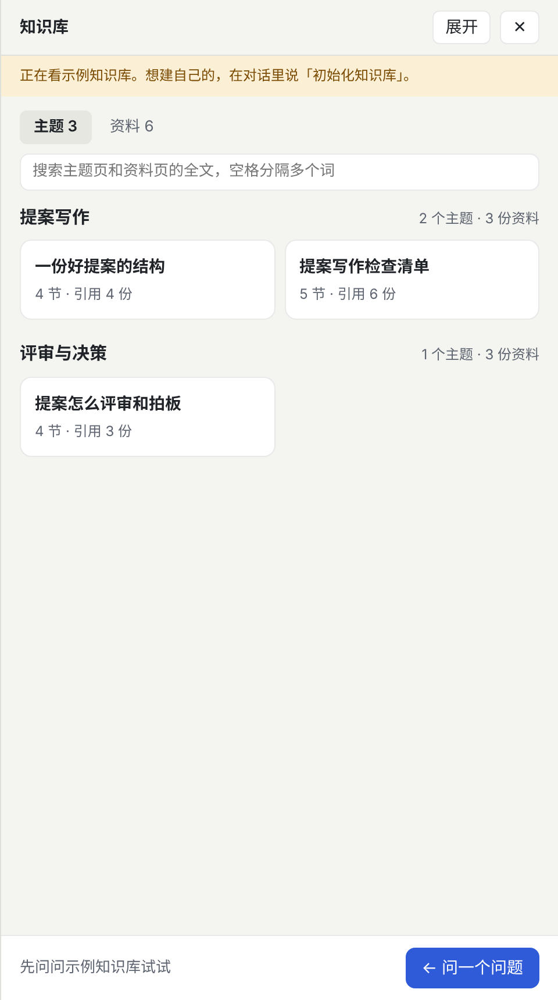
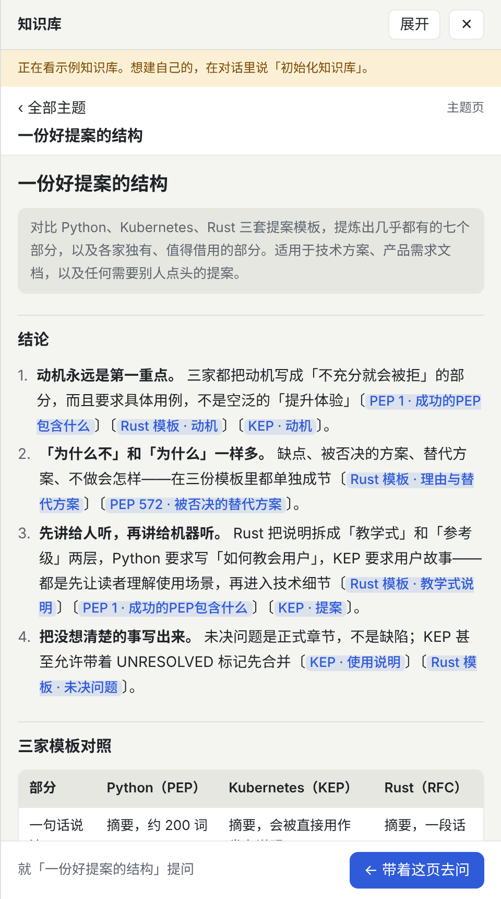
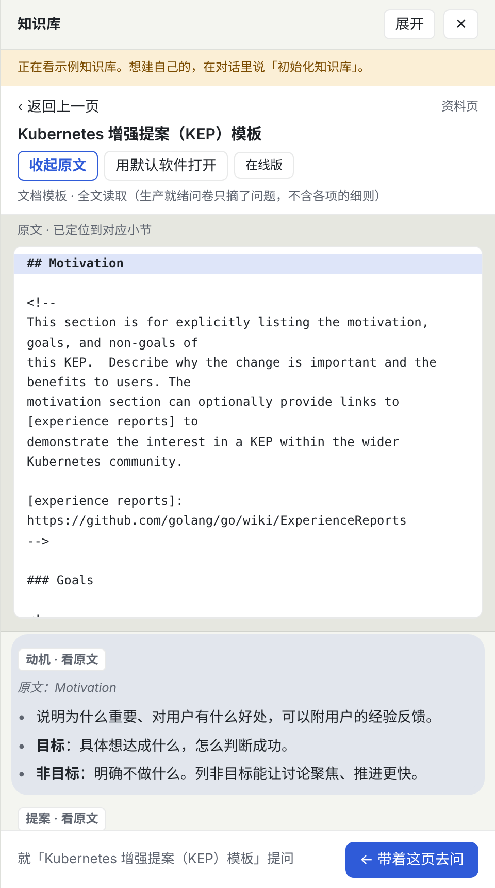
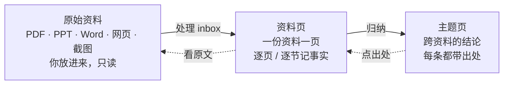

# AI 知识库

**你只管把资料放进来，整理交给 AI。**

一套用 AI agent 维护个人知识库的规则和模板。适用于任何能读写本地文件的 AI 工具：
Claude Code、Codex、Cursor、[DeepSeek Harness](https://www.deepseek.com/harness/)……
不需要数据库、不需要向量检索，全部是普通的 Markdown 文件，用任何编辑器或 Obsidian 都能打开。

思路来自 Andrej Karpathy 的 [LLM Wiki](https://gist.github.com/karpathy/442a6bf555914893e9891c11519de94f)：
让 AI 像维护维基一样维护你的笔记，而不是每次提问都从一堆原文件里重新检索。

<p>



</p>

*DeepSeek Harness 面板中的示例知识库：首页按领域分组；主题页的每条结论都带出处，点一下跳到资料页的对应小节，再一下看到原文。*

---

## 解决什么问题

- **存了很多，用的时候找不到。** 收藏的文章、别人的方案、自己的旧文档散落各处，要用时想不起在哪、说了什么。
- **整理靠人，坚持不下去。** 打标签、写摘要、建索引，开始很认真，一个月后就荒废了。
- **每次都要重新给 AI 讲背景。** AI 不知道你看过什么、认同什么，每次对话都从零开始。

这里的做法是：整理这件事完全交给 AI，按固定规则做；你只负责放资料和提问。

## 怎么运作



- **原始资料**：你的原文件，AI 只读不改。
- **资料页**：每份资料一页，按页码或小节记录它说了什么。只记事实，不加评价。
- **主题页**：跨资料的结论，例如「一份好提案的结构」「提案写作检查清单」。每条结论后面带出处，能一路追回原文。

你只需要说三句话：

| 你说 | AI 做什么 |
|---|---|
| 「处理 inbox」 | 读完 inbox 里的新资料，各写一页资料页，把新信息并入主题页，原文件归档，记日志 |
| 直接提问 | 先读主题页，再读资料页，必要时回原文核对；回答带出处，有价值的结论问你要不要写回 |
| 「体检」 | 先用校验脚本查出处链接、必填属性、孤立资料，再由 AI 查互相矛盾的结论、抽查资料页和原文是否一致 |

另外两句常用的：「**收进知识库**」（在对话里直接发文件、链接或文字，先存进 inbox），「**开工 / 收工 <项目名>**」（同一个项目在不同对话、不同 AI 工具之间交接，见 AGENTS.md）。

## 快速开始（不用命令行）

1. **下载**：点本页右上角的 **Code → Download ZIP**，解压到你喜欢的位置。
2. **打开**：用你的 AI 工具打开这个文件夹（在 Claude Code、Codex、Cursor、DeepSeek Harness 里选「打开文件夹 / 设为工作区」）。
3. **初始化**：对 AI 说「**初始化知识库**」。它会建好 `知识库/` 文件夹，问你三四个问题（做什么工作、知识库拿来干什么、最关心哪些主题），写进你的偏好页。
4. **放资料**：把文件拖进 `知识库/inbox/`，对 AI 说「**处理 inbox**」。
5. **提问**：「我写方案时最容易漏掉什么？」「上次那份竞品分析里的转化率是多少？」

> 想先看效果？在第 2 步之后直接问「示例知识库里讲了什么」，或用 [Obsidian](https://obsidian.md) 打开 `示例/知识库/` 文件夹。

第一次建议放 5 到 10 份资料。AI 每份都要完整读完，资料很多时分几批处理效果更好。

## 示例知识库

`示例/知识库/` 是一个完整的小知识库，主题是**怎么写一份好提案**。原始资料是 Python、Kubernetes、Rust、Go 四个开源社区公开的提案流程和模板：

| 主题页 | 回答什么 |
|---|---|
| 一份好提案的结构 | 三套模板对照，几乎都有的七个部分，各家独有、值得借用的部分 |
| 提案怎么评审和拍板 | 谁来决定、讨论放在哪、怎么防止没完没了、没有共识怎么办 |
| 提案写作检查清单 | 写完方案逐条对照，每条都能点回原文 |

这些结论对技术方案、产品需求文档同样适用。资料来源和许可见 [来源与许可](示例/知识库/来源与许可.md)。

## 最佳体验：DeepSeek Harness 面板

用 [DeepSeek Harness](https://www.deepseek.com/harness/) 的话，可以装上 `plugin/` 里的知识库面板，就是上面截图里的样子：

- 在对话旁边浏览主题页和资料页，点出处直接跳到资料页的那一页、那一节并高亮
- 全文搜索：搜主题页和资料页的正文，结果精确到页或小节
- 「看原文」：PDF / PPT 逐页翻预览图，Markdown 等文字原文自动定位到对应小节
- 「带着这页去问」：一键把当前页作为上下文填进对话框
- inbox 有新资料时，一键发出「处理 inbox」

安装：在 DeepSeek Harness 里打开本文件夹，对 agent 说「**帮我安装 plugin 文件夹里的知识库插件**」，然后重启。
（手动安装：`dsh plugin --profile web add ./plugin`，详见 [plugin/README.md](plugin/README.md)。）

**说清楚边界**：知识库本身（Markdown + 规则）任何 AI 工具都能读写，Obsidian 里点链接也能跳到对应小节；
但上面这些「点出处高亮、逐页看原文、按领域分组、全文搜索」只在 DeepSeek Harness 面板里有。
用别的工具时，你得到的是一个整理好的文件夹，体验取决于你用什么打开它。

## 怎么确认它真的靠谱

AI 写的东西需要能被检查。仓库里带了一个只读的校验脚本：

```
node plugin/scripts/kb-check.mjs 知识库
```

它检查每一处出处链接能不能找到对应的资料页和小节、资料页的必填属性、原文件在不在、有没有没被引用的资料。
示例知识库在每次提交时都会自动跑一遍（见 `.github/workflows/kb-check.yml`）。
脚本查不了「资料页写的数字和原文一不一致」，所以体检时还会让 AI 随机抽几条回原文核对，最好换一个对话来抽查。

## 规则在哪、怎么改

| 文件 | 是什么 | 要不要改 |
|---|---|---|
| `AGENTS.md` | 固定机制：三层结构、页面格式、出处格式、三个动作、安全规则 | 一般不用改。Claude Code 通过 `CLAUDE.md` 读到它 |
| `知识库/偏好.md` | 你的用法：用途、关心的主题、冲突怎么处理、关于你本人的资料要不要自动并入 | 随时改，或直接对 AI 说「把偏好里的……改成……」 |
| `模板/知识库/` | 初始化时复制的骨架，包括资料页、主题页、项目页的模板 | 想调整页面格式时改 |
| `docs/规则变更.md` | 每个规则版本改了什么、旧知识库怎么升级 | 不用改。规则升级后对 AI 说「按规则变更把我的知识库升级」 |

## 文件夹

```
AGENTS.md          给 AI 的工作规则（CLAUDE.md 指向它）
知识库/            你自己的知识库，初始化后出现，不进 git
  inbox/           新资料放这里
  原始资料/        处理过的原文件
  资料页/  主题页/  项目/
  偏好.md  日志.md
示例/知识库/       示例知识库
模板/知识库/       初始化用的骨架
plugin/            DeepSeek Harness 面板（可选）和两个脚本：预览图、校验
docs/方法.md       这套方法的来龙去脉
docs/规则变更.md   规则版本和升级说明
```

## 隐私

- `知识库/` 已写进 `.gitignore`，你的资料和笔记不会因为同步这个仓库被上传。
- AI 能执行命令时，会在 `知识库/` 里单独建一个 git 做版本记录（原始资料不进版本记录），改坏了可以找回。
- 规则要求 AI 不修改、不删除原始资料，不把内容推送到远程仓库或上传到别的网站。
- **但要知道**：AI 读资料、回答问题时，资料内容会发给你所用 AI 工具背后的模型服务商，这是所有 AI 工具都绕不开的。所以「不上传」不等于「全程只在本机」。公司机密、身份证件这类特别敏感的材料，请先确认你用的模型服务是否合规，或者干脆不放进来。
- 每份资料有一个「范围」（私密 / 工作 / 可公开），AI 写对外内容时只会用「可公开」的资料。

## 常见问题

**支持哪些格式？** AI 能读的都行：PDF、PPT、Word、Markdown、网页剪藏、截图。扫描件或图片里的字，AI 会逐页看图；读不出的部分会在资料页里如实写明。

**和「把文件丢给 AI 检索」有什么区别？** 检索每次都从原文重新找，答案不积累；这里 AI 读一次就把内容沉淀进资料页和主题页，下次直接用整理好的结论，还能互相引用、发现矛盾。

**我的 AI 工具不能执行命令，能用吗？** 能。只是不会生成原文预览图，也不会自动做版本记录。

**资料是别人写的，会不会评价作者？** 不会。规则要求只做摘录整理，不对作者本人做评价。

**怎么生成 PDF / PPT 的逐页预览？** AI 处理 inbox 后会尝试运行 `node plugin/scripts/kb-previews.mjs`，需要本机装有 Node 和 poppler（PPT / Word 还需要 LibreOffice）。没有也不影响使用。

## 许可

代码和规则采用 [MIT](LICENSE)。示例知识库里的原文件各有许可，见 [来源与许可](示例/知识库/来源与许可.md)。
